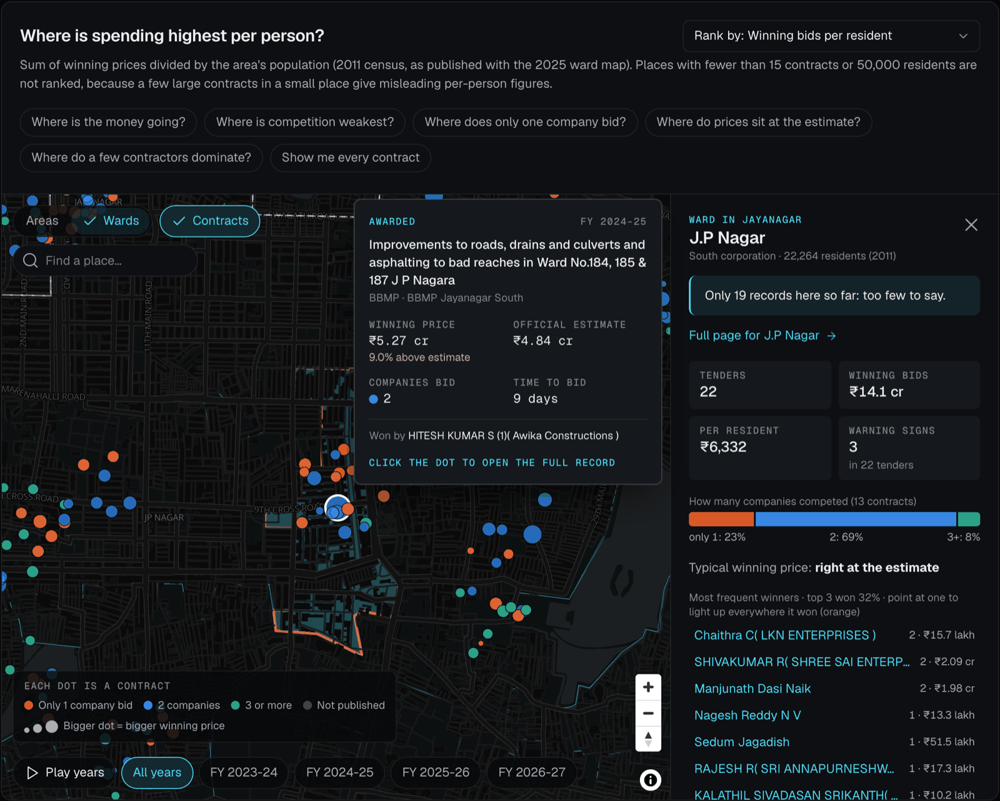
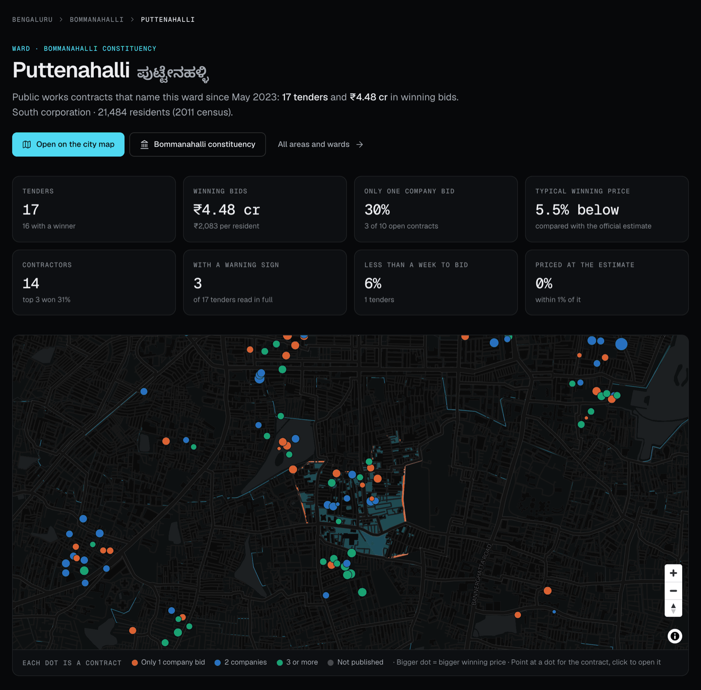
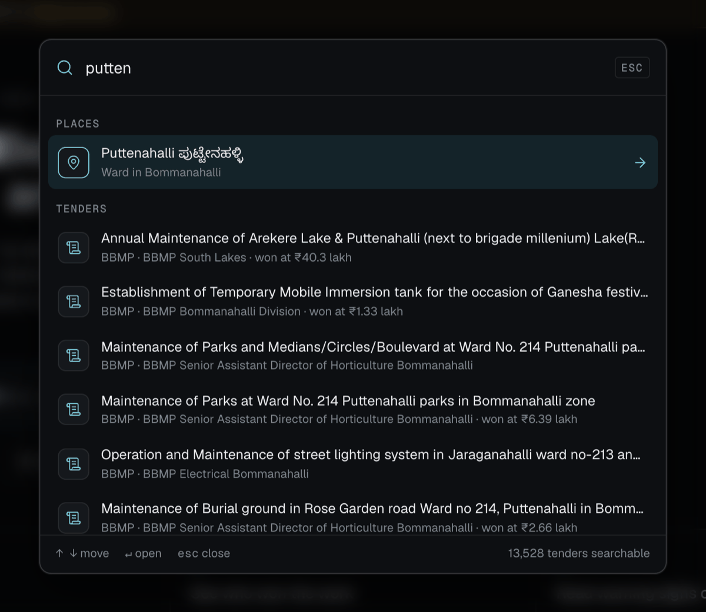

<picture>
  <source media="(prefers-color-scheme: dark)" srcset="web/public/logo-dark.svg">
  
</picture>

# CivicTrace Bengaluru

**See who gets Bengaluru's public works contracts, what they cost and where the money goes, ward by ward.**

CivicTrace Bengaluru is a free, open-source website for tracking public works tenders in Bengaluru (Bangalore): the
roads, drains, footpaths, streetlights, lakes and building repairs the city pays contractors to do. It reads the public
records on the Karnataka Public Procurement Portal (KPPP) and puts them on a map that anyone can use.

**Open the site: [civictrace-bengaluru.vercel.app](https://civictrace-bengaluru.vercel.app)**



*Puttenahalli ward after searching for it: the map shows only its contracts. Each dot is a contract, coloured by how
many companies bid and sized by its winning price. The ringed dot sits at Puttenahalli Lake, the place the tender
names; faded dots are somewhere in the ward. Pointing at one shows the work, the winner and the price against the
official estimate; the panel on the right sums up the ward.*

## How to use it

1. **Find your area.** Type your ward or neighbourhood, in English or Kannada, tap **Use my location**, or press
   **⌘K** (Ctrl+K) anywhere to search places, tenders and contractors.
2. **Look at the map.** Each dot is a contract. Point at one, or tap it on a phone, to see what the work was, who won
   it, the winning price, the government's own estimate and how many companies bid. A ringed dot sits on the lake,
   park, road or building named in the tender; a faded dot is only known to be somewhere in its ward. Pick a ward or
   area and the map shows only that place's contracts.
3. **Compare areas.** The list beside the map ranks places by winning bids per resident, by how often only one company
   bid, and more. The charts below the map follow the area you pick.
4. **Read the warning signs.** Every tender is checked for six patterns that can point to a rigged tender. Each warning
   sign shows its evidence and the ordinary reasons it could happen.
5. **Open your ward's page.** Every ward and constituency has its own page with its numbers, its contracts on the map,
   who wins the work and the most recent contracts. Browse them all at
   [/areas/](https://civictrace-bengaluru.vercel.app/areas/).
6. **Share what you find.** Every view has its own link, so you can send your neighbours the page for your ward.

| Every ward has its own page | Search with ⌘K |
|---|---|
|  |  |
| *[J.P Nagar](https://civictrace-bengaluru.vercel.app/wards/jp-nagar-south-14/): 30 tenders, ₹17.0 crore in winning bids, the share where only one company bid, and every contract on the map.* | *Search finds wards in English or Kannada, tenders by the words in their titles, contractors, departments and pages.* |

## What it covers

- **Who issues the tenders:** BBMP (Bruhat Bengaluru Mahanagara Palike), the Greater Bengaluru Authority (GBA), the
  five city corporations that replaced BBMP in 2025 (Central, East, North, South and West), B-SMILE and Bengaluru
  Solid Waste Management Limited.
- **What is recorded:** 13,528 public works tenders published since May 2023, with the estimate, the winning price,
  the winning contractor, the number of bidders, the deadlines and every change made after publication.
- **Where:** all 369 wards and 28 assembly constituencies, on the official 2025 ward map.
- **Who it is for:** residents and resident welfare associations (RWAs), journalists, researchers, elected
  representatives' offices, and anyone who wants to know how their area's money is spent.

Everything comes from public records and links back to its source. The code, the rules and the way each number is
calculated are open, so anyone can check them.

> **Warning signs are not proof.** They mark patterns worth a closer look. Nothing in this project alleges wrongdoing
> by any person or company.

## What's here

```
pipeline/   Python (uv): polite KPPP client, SQLite store, rules engine, static export, claims tooling
  config/   rules.yaml (thresholds + plain-language text), buyers.yaml, suppressions.yaml
  tests/    golden tests per rule, parser tests on recorded portal responses, claims/graph tests
web/        Next.js static site: interactive explorer, warning-sign evidence pages, tenders, suppliers, departments
data/       SQLite store (gitignored), raw archive (gitignored), claims/ and evidence/ (committed)
docs/       SOURCES.md (what the portal provides, verified), CORRECTIONS.md, images/ (README screenshots)
```

## Quick start

```bash
./tasks.sh ingest      # resumable; ≤1 request/second; the full backfill takes about a day
(cd pipeline && uv run civictrace ingest geo)   # official ward/corporation boundaries (OpenCity, public domain)
(cd pipeline && uv run civictrace ingest osm)   # named lakes, parks, roads and landmarks (OpenStreetMap, ODbL)
./tasks.sh status      # progress
./tasks.sh data        # snapshot → rules → export → build site → verify no relationship data in public build
./tasks.sh test        # pipeline tests, claims validation, web type-check
```

Preview the built site:

```bash
python3 -m http.server 3210 --directory web/out
```

`make` targets mirror `tasks.sh` for machines that have `make`.

## What the site shows

- **Area and ward pages** (`/areas/`, `/areas/<name>/`, `/wards/<name>-<key>/`): an overview of each of the 28
  constituencies and 369 wards, with a map zoomed to the place, plain numbers, top contractors, recent contracts, a
  yearly breakdown and links between a ward and its constituency. Each page has its own title, description, geo tags
  and structured data, and all of them are listed in `sitemap.xml`.
- **Site search** (⌘K / Ctrl+K or `/`): places, pages, warning signs, departments, contractors and tenders.
- **Interactive map** (home page): Bengaluru's 28 constituency areas and 369 wards (GBA delimitation 2025). It opens on
  "Where is the money going?", which shows winning bids per resident with the areas ranked beside the map. Places with
  fewer than 15 contracts or 50,000 residents are not ranked, because a few large contracts in a small place give
  misleading per-person figures. Other plain-question views show where competition is weakest, where only one company
  bids, where prices sit at the estimate and where a few contractors dominate. There are nine measures in all, plus
  individual contract dots, play-through-the-years, locality search, area profiles and a contractor's "where it won"
  footprint. Clicking an area filters every chart below it, and the URL keeps the view so it can be shared.
- **Explorer charts**: "who wins where", tenders published per month, competition, price vs estimate, time to bid,
  and changes to tenders after publication.
- **Tender pages**: the life of one tender, from publication to award. Each shows the estimate, the bid deadline and
  every change to it, every company that reached the price round with what it offered, and the winner.
- **Department pages**: each department's tenders and the value of its winning bids by year, its local offices
  (divisions), and how competition and prices compare there.
- **Supplier pages**: every tender a contractor won, from which department and in which year, with the price.
- **How widespread?** (`/findings`): plain-language answer to "how common are the warning signs?". Prevalence of each warning sign with
  95% intervals, the competition-vs-price comparison (overall and within each type of work), and an auto-generated
  verdict that changes with the data. Details are fetched in a month-stratified random order, so partial data works as a
  random sample.
- **Warning-sign evidence pages**, "How manipulation works", "How we check", a data coverage page, and a glossary with
  hover definitions for terms like *estimate*, *price round* and *reserved tender*.

Tenders are placed on the map by their engineering division (BBMP divisions follow assembly constituencies) and by
official ward names found in their titles, with spelling-tolerant matching. Ward numbers are ignored because titles mix
numbering schemes, and zone-wide departments are left off the map rather than guessed. About 75% of tenders get an
area and about 45% a ward. See `pipeline/civictrace/geo.py` and `pipeline/tests/test_geo.py`.

KPPP publishes no worksite coordinates. When a title names a place, such as "Annual Maintenance of Puttenahalli
Lake", the dot is put on that place using OpenStreetMap, but only when the place lies inside the tender's own ward
or area, the title says what kind of place it is ("lake", "park", "road"), and the name picks out one place. About
5% of tenders (673) are placed this way, mostly lakes and roads. Every other dot is approximate: inside its ward, not
at the worksite. See `pipeline/civictrace/sites.py` and `pipeline/tests/test_sites.py`.

## The warning signs (rules 1–6)

| # | Plain name | Technical basis |
|---|---|---|
| 1 | One contractor wins unusually often | OCP R040; binomial test vs even split, Benjamini–Hochberg |
| 2 | Only one company competed | OCP R018; price-stage bidder count from the published comparative statement |
| 3 | Very little time to bid | OCP R003; IQR fence within buyer × work category × call type, plus materiality floor |
| 4 | Deadline or terms changed repeatedly | ≥3 corrigenda or ≥2 deadline extensions (calls ending in no bids excluded) |
| 5 | Winning price far from the official estimate | OCP R031; log-ratio IQR fences plus materiality floors |
| 6 | A few contractors get most of the work | OCP R051; HHI > 1800 or top-3 share ≥ 60%, ≥50 contracts |
| 7 | Mentioned in an official audit | Planned (CAG / Lokayukta, human-reviewed matches only) |

Thresholds and all explanatory text live in `pipeline/config/rules.yaml`. Each rule is versioned.

## Publication safeguards

- **Only what the portal publishes.** Contractor names appear exactly as KPPP shows them. Officials' phone numbers are
  never extracted.
- **Integrity checks.** Any response whose tender number doesn't match is quarantined and never attributed.
  Implausible award values are quarantined too.
- **No scores or leaderboards** of people or companies. Supplier pages are excluded from search engines (`noindex`).
- **Suppressions.** `pipeline/config/suppressions.yaml` withholds disputed items while a correction is reviewed.
- **Political-relationship layer is not public.** Claims (`data/claims/*.yaml`) must cite a verbatim excerpt from an
  official document, with a page locator and hashed evidence, and need a second reviewer. They are only exported with
  `./tasks.sh internal`, and `./tasks.sh data` fails if relationship data leaks into the public build. A person appears
  only if a complete documented chain links them to a KPPP supplier; holding an office alone never does.

## Taking part

CivicTrace is open source so that its numbers can be checked, not just read.

- **Spot an error?** Use "Report an error" on the site or email the corrections address. Disputed items are withheld
  while they are checked (see `docs/CORRECTIONS.md`).
- **Question a rule.** Thresholds and every sentence the site shows about a rule are in `pipeline/config/rules.yaml`,
  and each rule has golden tests in `pipeline/tests/test_rules.py`. Change a threshold, rerun `./tasks.sh data`, and
  see what moves.
- **Reuse the data.** Every number on the site is served as static JSON under `/data/`, rebuilt by `./tasks.sh data`.
  The tender records are KPPP's, reproduced with acknowledgement (see below).

Issues and pull requests are welcome.

## Data source and terms

KPPP's copyright policy allows free reproduction of its material if it is reproduced accurately and the source is
acknowledged. CivicTrace uses the portal's public JSON service at no more than one request per second, archives every
response with a sha256 hash, and never bypasses CAPTCHAs or logins. See `docs/SOURCES.md`.

Place locations come from OpenStreetMap: © OpenStreetMap contributors, available under the
[Open Database Licence](https://opendatacommons.org/licenses/odbl/). The map credits them too.

## Built by

Dakshin Raj Siva — [github.com/dakshinsiva](https://github.com/dakshinsiva) · [LinkedIn](https://www.linkedin.com/in/dakshinsiva/) ·
dakshinrajsiva@gmail.com

## Licence

Code: MIT. Data: as published by the Government of Karnataka (KPPP), reproduced with acknowledgement. Place
locations: © OpenStreetMap contributors (ODbL).
